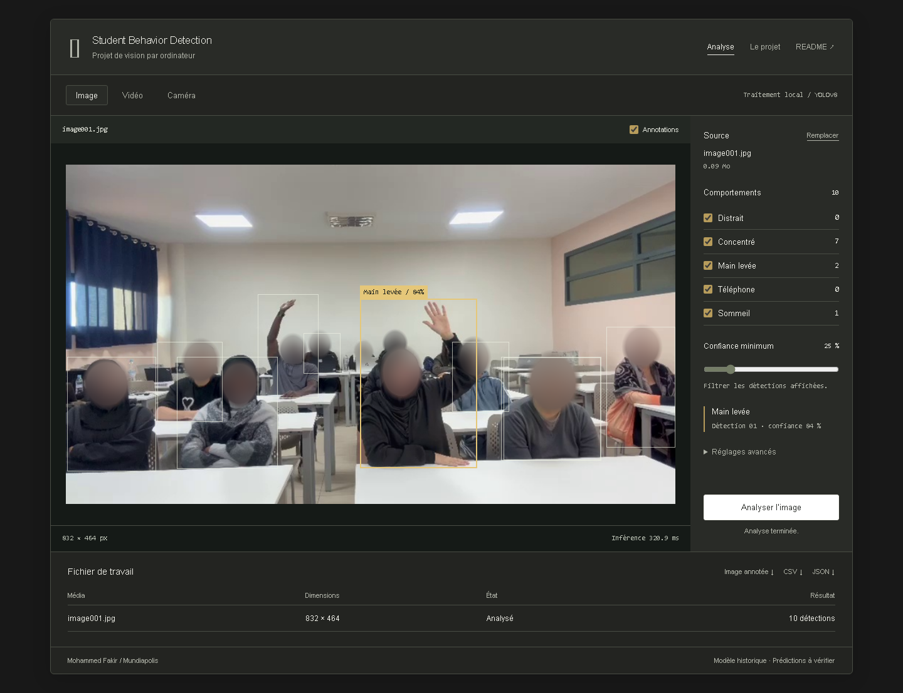
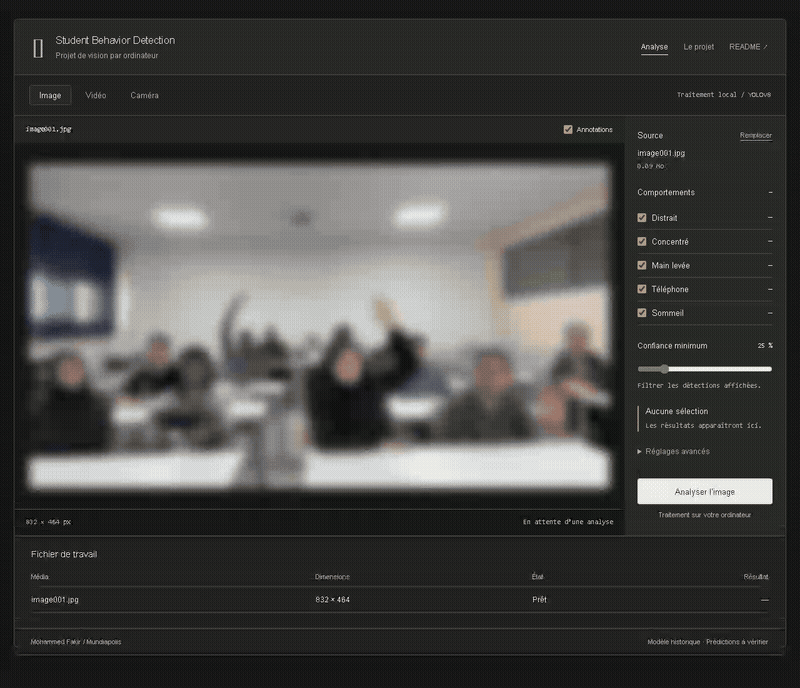
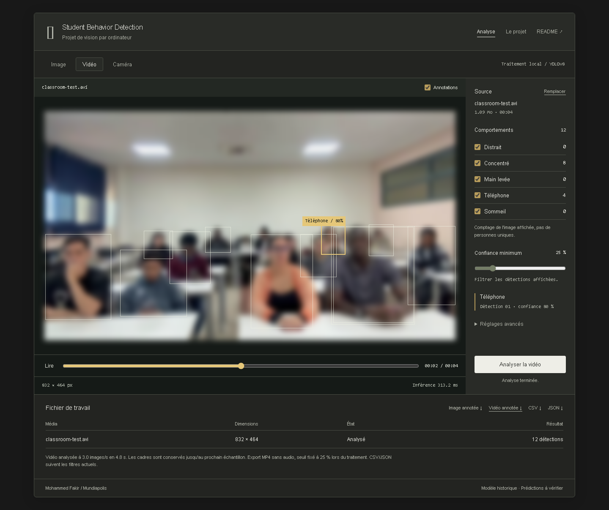
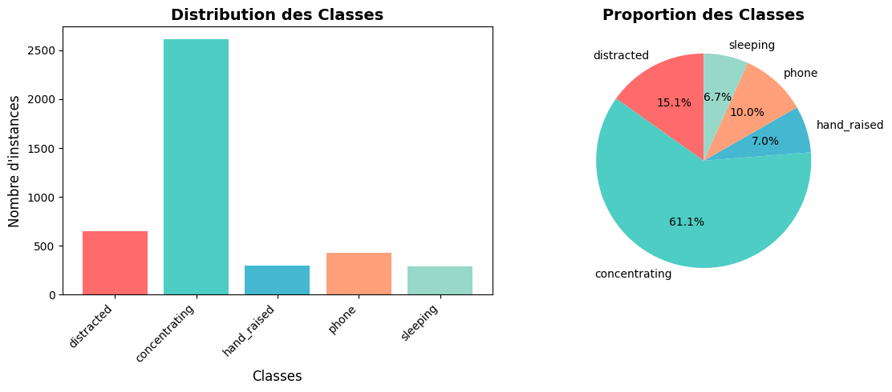

# Student Behavior Detection with YOLOv8

A local workspace for reviewing classroom behavior in **images, video and a live camera**. The interface is built with **React + Vite**, with a **FastAPI** server running the existing YOLOv8m model. It detects five classes: concentrating, distracted, hand raised, phone and sleeping.

The interface keeps the media in the foreground: select a detection, inspect its confidence, filter classes and export the result. Labels are in French. There is no account, hosted API or external font dependency.



*Real predictions from the included historical weights on a project image. Only faces are blurred in the screenshots.*

## See it in use



[Watch or download the MP4 walkthrough](assets/interface-demo.mp4).



*The video demonstration uses a short sequence assembled from project images to exercise the real video pipeline. It is not a benchmark or a continuous classroom recording.*

## The workspace

| Mode | What you can do |
|---|---|
| Image | Drop a file or use the project example; analyze, select boxes, adjust the confidence filter and export an annotated PNG. |
| Video | Upload a clip, follow progress, cancel, play or seek the result, and download an annotated H.264 MP4. |
| Camera | Start explicitly, review processed snapshots with measured request latency, and stop the camera. |
| Results | Export filtered detections as CSV or JSON; inspect model information and limitations. |

- **Instant display filters:** inference returns detections down to confidence 0.10. Moving the confidence slider or toggling classes filters these results in the browser without rerunning YOLO.
- **Video processing:** 4 sampled images/s by default, with 2 or 8 available in advanced settings. The actual rate is derived from the source frame rate. Boxes remain visible until the next sampled image; this is detection, not identity tracking. Counts refer to the current sampled image, not unique students.
- **Exports:** image and CSV/JSON exports use the current display filters. The annotated MP4 uses all classes and the confidence threshold selected when the analysis started. Rerun analysis to change that video's annotations.
- **Limits:** images up to 25 MB / 25 megapixels; video up to 200 MB / 10 minutes. Video previews and exports are resized to at most 1280 pixels on the longest side and contain no audio.
- **Local lifecycle:** images and camera snapshots are not retained after the request completes. Video files are temporary, with at most eight retained jobs and two pending/running jobs. Completed jobs expire after one hour without access, with cleanup on a subsequent API request; everything is removed on normal server shutdown. Do not use this local application as an unauthenticated public service.

The model is loaded once, on the first analysis. First-use latency includes model initialization; later timings are measured and shown in the interface. Camera requests run one at a time to avoid a backlog. Inference speed depends on the machine and selected PyTorch device.

## Team project

Course project at Mundiapolis University (Casablanca), academic year 2025-2026, done by a team of 8 students under the supervision of their professor. This repository is maintained by Mohammed Fakir, who refactored the original notebook into the package below.

## Results

Numbers from the original training run (YOLOv8m, 25.9 M parameters, trained on a free Colab T4 in about 33 minutes, `conf=0.25`, `iou=0.6` for val), as reported in the team's project report:

| Split | Images | mAP50 | mAP50-95 | Precision | Recall |
|-------|-------:|-------|----------|-----------|--------|
| Validation | 145 | 0.765 | 0.485 | 0.755 | 0.761 |
| Test | 73 | 0.812 | 0.468 | 0.774 | 0.745 |

Per class on the test split (from the report):

| Class | Precision | Recall | mAP50 | mAP50-95 |
|-------|----------:|-------:|------:|---------:|
| hand_raised | 0.819 | 0.946 | 0.936 | 0.615 |
| concentrating | 0.785 | 0.870 | 0.864 | 0.497 |
| phone | 0.870 | 0.892 | 0.860 | 0.466 |
| sleeping | 0.593 | 0.569 | 0.748 | 0.434 |
| distracted | 0.803 | 0.445 | 0.650 | 0.330 |

*distracted* and *sleeping* are the weak spots (recall 0.45 and 0.57): they are visually close to *concentrating*, and they are the classes with the fewest examples.

> **Read this before quoting the numbers.** The original notebook ([`notebooks/YOLO_Controle_original.ipynb`](notebooks/YOLO_Controle_original.ipynb)) augmented the whole dataset *first* (430 originals grew to ~725 images) and split it *afterwards* (507 / 145 / 73). Augmented copies of the same photo could therefore land in both train and test, which inflates these scores. The weights from that run are kept in [`models/best_legacy_run.pt`](models/best_legacy_run.pt) for the demo, but the tables above should be read as an upper bound.
>
> This repository fixes the pipeline (split first, augment the train split only — see below). The numbers for the fixed pipeline come from running `behavior-detection train` and `evaluate` yourself; I will publish them here once the clean run is done.

## The dataset

The team staged realistic classroom scenarios (one student per target behavior, fixed camera at the teacher's position, natural lighting), filmed them, extracted frames and annotated every visible student with [LabelImg](https://github.com/HumanSignal/labelImg). Work was split between members, with a cross-check of a sample of the annotations.

The result is 425 labeled photos (YOLO format, one `.txt` per image) with 4,271 boxes over 5 classes:

| Class | Boxes | Images containing it |
|-------|------:|------:|
| concentrating | 2,610 | 424 |
| distracted | 647 | 292 |
| phone | 426 | 187 |
| hand_raised | 300 | 156 |
| sleeping | 288 | 192 |



The classes are strongly imbalanced (*concentrating* is 61% of the boxes), which is why the pipeline balances the training set. Five further photos have no annotations and are kept in `data/raw/unlabeled/`.

The photos show the team members and their classmates. Please use them for this project only and do not try to identify anyone in them. If you appear in a photo and want it removed, email me (below).

## Intended use

A decision aid for teachers, not a surveillance or grading tool: the predictions should never be used to grade students, sanction them automatically, or replace a teacher's judgment. The model is also only validated on this one classroom setup (fixed front camera), so expect lower accuracy with other angles, heavy occlusion or low light.

## How the pipeline works

```
data/raw  ──►  split (70/20/10, seeded)  ──►  balance TRAIN only  ──►  data/prepared  ──►  train  ──►  evaluate / app
 originals       by source image               augment rare classes      YOLO layout        YOLOv8m
```

1. **Validate** (`check`): every label line is parsed; bad class ids or non-normalized coordinates are reported instead of silently ignored.
2. **Split first** (`prepare`): the original images are shuffled with a fixed seed and cut 70/20/10. Val and test therefore never contain an augmented copy of a training image. Which image went where is written to [`data/split.json`](data/split.json).
3. **Balance the train split only**: each class is brought up to 70% of the most common class by generating augmented copies (lighting, noise/blur, small camera shifts, JPEG compression — no horizontal flip, it would mirror the scene). Copies are always made from original images, and `data/prepared` is rebuilt from scratch on every run, so nothing goes stale.
4. **Train**: YOLOv8m, AdamW, cosine LR, mosaic/mixup/copy-paste. All hyper-parameters live in [`configs/default.yaml`](configs/default.yaml).

The original notebook also cached intermediate results in pickle files. Those are gone: stale caches are a source of silent bugs, and unpickling an unknown file can execute code.

## Quick start

Requirements: **Python 3.11+ recommended**, **Node.js 22.12+** (Node 24 also works), and npm. Run these commands from the repository directory. The included `models/best_legacy_run.pt` weights let you try the app without retraining.

### Windows / PowerShell

```powershell
python -m venv .venv
.venv\Scripts\python.exe -m pip install -r requirements.txt

cd frontend
npm ci
npm run build
cd ..

.venv\Scripts\python.exe -m behavior_detection.cli app --weights models/best_legacy_run.pt
```

Open **http://127.0.0.1:7860**. The Python server serves both the API and the built React application. Subsequent starts can use `./scripts/start.ps1`, which rebuilds the frontend and launches the server. Stop with Ctrl+C.

### macOS / Linux

```bash
python3 -m venv .venv
source .venv/bin/activate
pip install -r requirements.txt
cd frontend
npm ci
npm run build
cd ..
behavior-detection app --weights models/best_legacy_run.pt
```

The app selects `models/best.pt` when available, otherwise the bundled historical weights. It identifies historical weights in the interface. Use `--weights PATH` to select another compatible model, `--device cpu` or `--device 0` to choose the device, and `--port 7861` to change the local port. For CUDA, install the appropriate [PyTorch build](https://pytorch.org/get-started/locally/) before the project dependencies.

### Frontend development

Keep the API running on port 7860, then open a second terminal:

```bash
cd frontend
npm run dev
```

Vite serves **http://127.0.0.1:5173** and proxies `/api` to FastAPI. To use a different API port, update the proxy in `frontend/vite.config.js`. Rebuild with `npm run build` before using the Python-served interface again. Camera access requires localhost or HTTPS and browser permission; the app never opens it automatically.

### Reproduce the model pipeline

The existing preparation, training and evaluation commands are unchanged:

```bash
behavior-detection check
behavior-detection prepare
behavior-detection train
behavior-detection evaluate
behavior-detection app
```

A GPU is strongly recommended for training. See `configs/default.yaml` for paths, classes and training settings.

### Checks

```bash
pip install -e ".[app,dev]"
python -m pytest -q
cd frontend
npm test
npm run build
```

Backend tests cover the existing data pipeline, image validation, video sampling, H.264 exports, HTTP range playback and cancellation. They use a small test detector and do not require a GPU. Frontend tests cover video sample lookup, display filtering and CSV generation. The new interface was additionally exercised with the included YOLO weights on an image, a short assembled video and a synthetic browser camera.

### API

Interactive API documentation: **http://127.0.0.1:7860/docs**.

| Endpoint | Purpose |
|---|---|
| `GET /api/meta` | Classes, model information, defaults and upload limits |
| `GET /api/example` | Project example image, when installed |
| `POST /api/image` | Multipart `file`; optional `iou`; normalized boxes and inference time |
| `POST /api/videos` | Multipart `file`; optional `sample_fps`, `iou`, `confidence`; returns a job ID |
| `GET /api/videos/{id}` | State, progress and any processing error |
| `DELETE /api/videos/{id}` | Request cancellation |
| `GET /api/videos/{id}/results` | Timestamped sampled detections after completion |
| `GET /api/videos/{id}/preview.mp4` | Browser-compatible video without painted annotations |
| `GET /api/videos/{id}/annotated.mp4` | Downloadable annotated video |

### Troubleshooting

- **Connection error:** start the Python server; Vite alone does not run YOLO.
- **Missing weights:** pass `--weights models/best_legacy_run.pt`, or train your own model. Model class order must match the config.
- **No detections:** try the included example or a lower confidence threshold; some scenes do not resemble the training data.
- **No video preview before processing:** the browser may not support the uploaded codec. Analyze it to obtain a compatible MP4.
- **Camera refused:** allow camera access for localhost, close other apps using it, and retry. Camera snapshots are not stored.
- **Upgrade from Gradio:** rebuild `frontend/`; the `app` command now starts FastAPI. The former Gradio-specific `--share` option has been removed.

## Project structure

```text
frontend/                       React + Vite interface, CSS, filtering/export tests
  src/App.jsx                   media import, analysis, playback, camera, exports
  src/styles.css                responsive workspace matching the approved mockup
  src/results.js                sampled-frame lookup, filtering and export helpers
  dist/                         production bundle (generated, not committed)
src/behavior_detection/
  app.py                        local application launcher
  web.py                        FastAPI routes and static frontend serving
  inference.py                  single shared YOLO model and normalized detections
  video_jobs.py                 bounded jobs, progress, cancellation and MP4 encoding
  dataset.py, split.py           label validation and seeded data splitting
  augment.py, prepare.py         training-only augmentation and dataset preparation
  train.py, evaluate.py          training and evaluation wrappers
  cli.py                        behavior-detection commands
configs/default.yaml            model classes, paths and pipeline settings
models/best_legacy_run.pt        original training weights (see Results caveat)
data/raw/                       labeled project images; separate usage terms below
data/split.json                 reproducible split manifest
assets/                         interface screenshots, demo GIF/MP4 and dataset figure
scripts/start.ps1               Windows launcher
tests/                          pipeline and API tests
notebooks/                      original notebook, retained for reference
```

## Tech stack

React · Vite · CSS · FastAPI · Uvicorn · Ultralytics YOLOv8 · PyTorch · OpenCV · FFmpeg · Albumentations

## Need something?

Questions, a bigger or cleaner version of the dataset, the Colab notebook, a trained model for another classroom setup — just email me: **mr.fakir.mohammed@gmail.com**.

## License

Code: MIT, see [LICENSE](LICENSE). The images in `data/raw` are not covered by that license (see *The dataset*).
