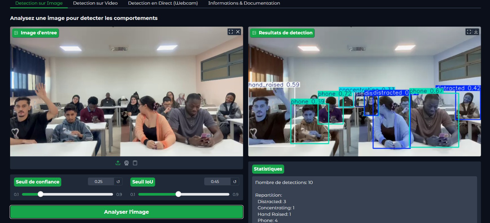
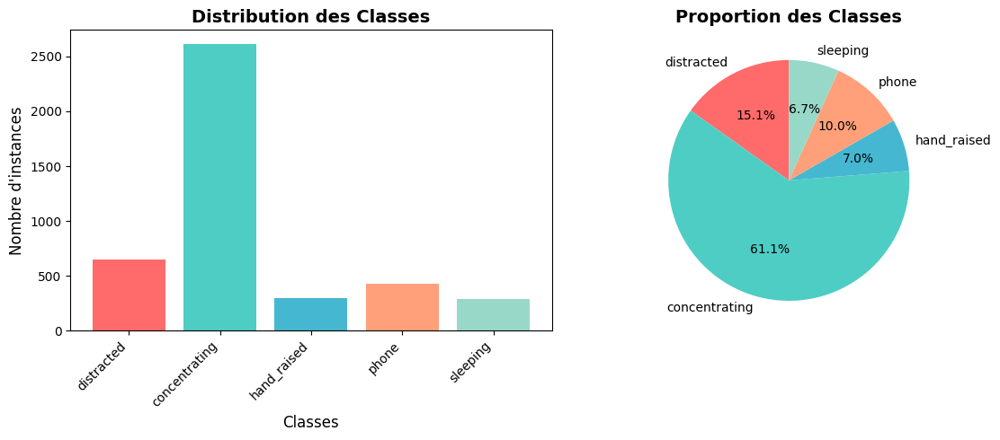

# Student Behavior Detection with YOLOv8

Detect what students are doing in a classroom image, video or live webcam stream: **concentrating, distracted, hand raised, using a phone, sleeping**. YOLOv8-medium fine-tuned on a classroom dataset the team filmed and annotated itself, with a reproducible data pipeline, a leak-free train/val/test split and a Gradio demo.



*The Gradio demo on a classroom image (confidence 0.25, IoU 0.45): the model flags the raised hand, the phones, the distracted and concentrating students. Interface labels are in French.*

## Team project

Course project at Mundiapolis University (Casablanca), academic year 2025-2026, done by a team of 8 students under the supervision of their professor. This repository is maintained by Mohammed Fakir, who refactored the original notebook into the package below.

## Results

Numbers from the original training run (YOLOv8m, 25.9 M parameters, trained on a free Colab T4 in about 33 minutes, `conf=0.25`, `iou=0.6` for val), as reported in the team's project report:

| Split | Images | mAP50 | mAP50-95 | Precision | Recall |
|-------|-------:|-------|----------|-----------|--------|
| Validation | 145 | 0.765 | 0.485 | 0.755 | 0.761 |
| Test | 73 | 0.812 | 0.468 | 0.774 | 0.745 |

Per class on the test split (from the report):

| Class | Precision | Recall | mAP50 | mAP50-95 |
|-------|----------:|-------:|------:|---------:|
| hand_raised | 0.819 | 0.946 | 0.936 | 0.615 |
| concentrating | 0.785 | 0.870 | 0.864 | 0.497 |
| phone | 0.870 | 0.892 | 0.860 | 0.466 |
| sleeping | 0.593 | 0.569 | 0.748 | 0.434 |
| distracted | 0.803 | 0.445 | 0.650 | 0.330 |

*distracted* and *sleeping* are the weak spots (recall 0.45 and 0.57): they are visually close to *concentrating*, and they are the classes with the fewest examples.

> **Read this before quoting the numbers.** The original notebook ([`notebooks/YOLO_Controle_original.ipynb`](notebooks/YOLO_Controle_original.ipynb)) augmented the whole dataset *first* (430 originals grew to ~725 images) and split it *afterwards* (507 / 145 / 73). Augmented copies of the same photo could therefore land in both train and test, which inflates these scores. The weights from that run are kept in [`models/best_legacy_run.pt`](models/best_legacy_run.pt) for the demo, but the tables above should be read as an upper bound.
>
> This repository fixes the pipeline (split first, augment the train split only — see below). The numbers for the fixed pipeline come from running `behavior-detection train` and `evaluate` yourself; I will publish them here once the clean run is done.

## The dataset

The team staged realistic classroom scenarios (one student per target behavior, fixed camera at the teacher's position, natural lighting), filmed them, extracted frames and annotated every visible student with [LabelImg](https://github.com/HumanSignal/labelImg). Work was split between members, with a cross-check of a sample of the annotations.

The result is 425 labeled photos (YOLO format, one `.txt` per image) with 4,271 boxes over 5 classes:

| Class | Boxes | Images containing it |
|-------|------:|------:|
| concentrating | 2,610 | 424 |
| distracted | 647 | 292 |
| phone | 426 | 187 |
| hand_raised | 300 | 156 |
| sleeping | 288 | 192 |



The classes are strongly imbalanced (*concentrating* is 61% of the boxes), which is why the pipeline balances the training set. Five further photos have no annotations and are kept in `data/raw/unlabeled/`.

The photos show the team members and their classmates. Please use them for this project only and do not try to identify anyone in them. If you appear in a photo and want it removed, email me (below).

## Intended use

A decision aid for teachers, not a surveillance or grading tool: the predictions should never be used to grade students, sanction them automatically, or replace a teacher's judgment. The model is also only validated on this one classroom setup (fixed front camera), so expect lower accuracy with other angles, heavy occlusion or low light.

## How the pipeline works

```
data/raw  ──►  split (70/20/10, seeded)  ──►  balance TRAIN only  ──►  data/prepared  ──►  train  ──►  evaluate / app
 originals       by source image               augment rare classes      YOLO layout        YOLOv8m
```

1. **Validate** (`check`): every label line is parsed; bad class ids or non-normalized coordinates are reported instead of silently ignored.
2. **Split first** (`prepare`): the original images are shuffled with a fixed seed and cut 70/20/10. Val and test therefore never contain an augmented copy of a training image. Which image went where is written to [`data/split.json`](data/split.json).
3. **Balance the train split only**: each class is brought up to 70% of the most common class by generating augmented copies (lighting, noise/blur, small camera shifts, JPEG compression — no horizontal flip, it would mirror the scene). Copies are always made from original images, and `data/prepared` is rebuilt from scratch on every run, so nothing goes stale.
4. **Train**: YOLOv8m, AdamW, cosine LR, mosaic/mixup/copy-paste. All hyper-parameters live in [`configs/default.yaml`](configs/default.yaml).

The original notebook also cached intermediate results in pickle files. Those are gone: stale caches are a source of silent bugs, and unpickling an unknown file can execute code.

## Quick start

```bash
git clone https://github.com/Symooomzip/student-behavior-detection-yolov8.git
cd student-behavior-detection-yolov8
python -m venv .venv && source .venv/bin/activate     # Windows: .venv\Scripts\activate
pip install -r requirements.txt                       # for GPU training, install a CUDA build of PyTorch first
```

Try the demo with the included weights (image, video or webcam):

```bash
behavior-detection app --weights models/best_legacy_run.pt
```

Reproduce the whole pipeline:

```bash
behavior-detection check       # validate raw labels + class statistics
behavior-detection prepare     # split, then balance the train split  ->  data/prepared
behavior-detection train       # a GPU is strongly recommended (a free Colab T4 works); best weights -> models/best.pt
behavior-detection evaluate    # mAP / precision / recall on val and test
behavior-detection app         # demo with the weights you just trained
```

On Colab: `!pip install -q -r requirements.txt` after cloning, then run the same commands.

## Project structure

```
.
├── configs/default.yaml        # classes, paths, split, augmentation and training settings
├── data/
│   ├── raw/                    # 425 labeled originals (images/ + labels/ + classes.txt)
│   │   └── unlabeled/          # 5 photos without annotations
│   └── split.json              # which image is in train / val / test
├── models/best_legacy_run.pt   # weights of the original run (see the caveat above)
├── notebooks/                  # the original Colab notebook, kept for reference
├── src/behavior_detection/
│   ├── dataset.py              # parsing + validation of YOLO labels
│   ├── split.py                # seeded split of original images
│   ├── augment.py              # albumentations pipeline + class balancing
│   ├── prepare.py              # raw -> data/prepared + data.yaml + manifest
│   ├── train.py  evaluate.py   # ultralytics wrappers
│   ├── app.py                  # Gradio demo (image / video / webcam)
│   └── cli.py                  # `behavior-detection` command
└── tests/                      # split / leakage / label parsing tests (no GPU needed)
```

Run the tests with `pip install pytest && pytest`.

## Tech stack

Python · Ultralytics YOLOv8 · PyTorch · Albumentations · OpenCV · Gradio

## Need something?

Questions, a bigger or cleaner version of the dataset, the Colab notebook, a trained model for another classroom setup — just email me: **mr.fakir.mohammed@gmail.com**.

## License

Code: MIT, see [LICENSE](LICENSE). The images in `data/raw` are not covered by that license (see *The dataset*).
